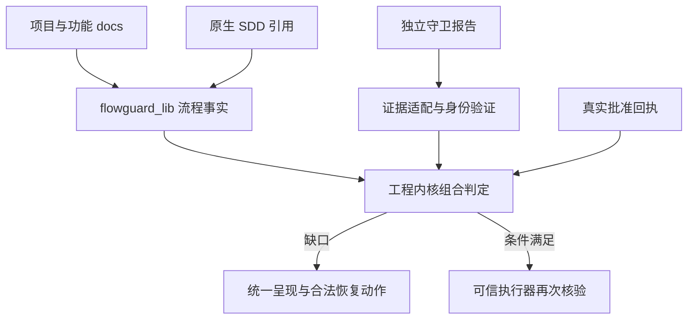

# FlowGuard 工程守卫集成规划

来源：feature: partme-engineering-guard。日期：2026-10-09。状态：规划，新增能力未实施；未初始化 OpenSpec。

## 权威入口

- [现有十阶段规格第 7 节](superpowers/specs/2026-09-23-flowguard-docs-ten-stage-governance.md)：EG-WF-001—008。
- [现有实施计划第 5 节](superpowers/plans/2026-09-23-flowguard-agent-driven-sdd-governance.md)：EG-W01—12，唯一新增任务账本。
- 共享架构/协议：仓库 `codeguard` 的 `docs/engineering-guard/README.md`、`protocol.md` 及 `openspec/changes/add-engineering-guard-core/`。发布前按仓库路径查阅；发布后固定 release manifest 摘要，不假定用户本机存在兄弟仓库。

## 现状与增量

当前 `scripts/flowguard_lib/governance.py` 已负责动作矩阵，`stage_docs.py` 管理 docs 阶段，`evidence.py` 管理证据，`codereview_evidence.py` 已有当前 index/会话/报告验证。应增量适配这些模块，不能从“尚无协作”假设重新实现。

| 范围 | 计划变化 | 保留约束 |
|---|---|---|
| 发现/上下文 | Registry 引用当前 SDD/任务/worktree/会话身份 | 不自动安装/初始化、不复制原生规格 |
| 阶段 | 只读导出可核验状态与文档摘要 | 十阶段所有权及 docs 目录不变 |
| 证据 | 共同 envelope + 旧 producer 显式投影 | 最新失败优先、当前候选匹配 |
| 批准 | 对接独立 receipt，范围授权与验收分离 | 不以 actor/source 字符串自证用户 |
| 治理 | standalone 旧路径；受控模式组合内核决定 | flowguard_lib 唯一流程语义，不在 OPA 重写阶段规则 |
| 协调 | operationId 单飞、问题 owner、依赖恢复 | 不直接写兄弟插件状态，不重复已授权询问 |
| 技能 | 修改 scripts/templates/workflows.py 再生成 | 不手改生成物或受管技能 |

## 调用与状态设计

新增 evidence/flow projection 通过版本能力协商；具体命令在协议冻结后实现，本轮不假定已有。输出包括 task/session/worktree、原生 spec 来源、阶段文档摘要、前置依赖、有效批准引用和缺失项；状态字段本身不带可信权威。内核收到事实后独立核验来源和实际候选，再组合动作决定。

原批准生命周期：范围批准在授权范围内复用；阶段/发布验收绑定 docs 与候选，相关上游改变失效。用户继续审查发现不能改写 report；例外和风险接受须符合冻结策略。对于无可核验 receipt 的宿主，仍可指导协作，但不宣称对抗性强制。

恢复行为：read/spec_write 和符合上下文的 test_write 保持开放；若 scope/receipt 缺失，列出具体 allowed_actions。取消/预算耗尽/工具不可用不自动跳阶段。修复只调整候选代码或提交契约变更候选，不能由 Agent 降低验收标准。

## P0—P4 与部署

P0 共同证据、流程投影、receipt/动作桥接；P1 领域与 API 风险映射；P2 实际宿主和模板；P3 并行依赖与设计 REVIEW；P4 历史/跨仓/平台追踪。Python 仅标准库保持；Rust/OPA/SQLite 在共享内核侧，通过固定协议调用。宿主私有缓存不改成新的项目事实源。

先 shadow 对照、后显式 cooperative、最后独立 CI/权限验收后 enforced。回滚保留原生文档、批准/撤销历史和证据；不得恢复已下线布局或自动撤去服务端保护。

## 验证和风险

先编写跨会话/旧指纹/limited 审查/伪造 receipt/多 Hook 重入反例，再实现与回归。执行 unittest（非 pytest）、技能/命令生成 parity、vendor 离线与在线、manifest/协议一致性；真实宿主安装及远端 required check 另行留证。

最大风险是“本地 accepted 可写”与“模型自报用户同意”；解决依赖独立身份，不通过增加状态字段宣称已解决。多插件 Hook 不保证固定顺序，所以测试必须覆盖重入、乱序及某插件未安装。
